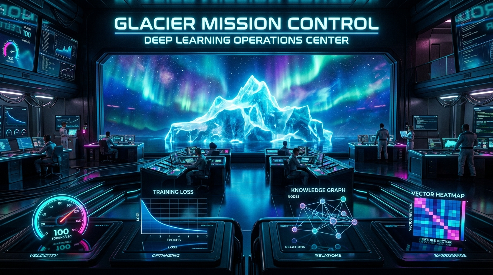
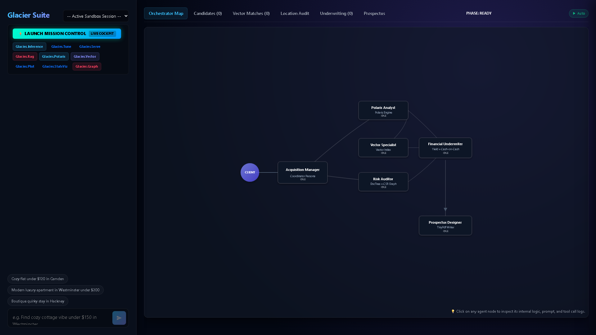
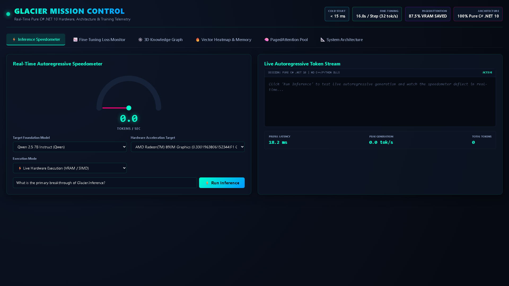
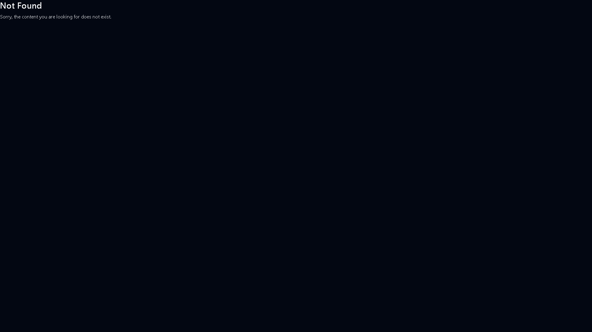

# Glacier.Showcase

**Unified .NET 10 Blazor Web Cockpit demonstrating 15 Glacier ecosystem libraries across multi-agent orchestration, real-time hardware telemetry, and live CPU vs GPU benchmarks.**

*Version `1.2.0` | Blazor InteractiveServer (.NET 10) | 15 Integrated Glacier Subsystems*

## Overview

`Glacier.Showcase` brings the Glacier C# stack together in one local web application. Instead of isolated toy examples, it exercises real `Glacier.Agent` tool-calling workflows, `Glacier.Rag` + `Glacier.Vector` + `Glacier.Graph` retrieval over tabular and document data, `Glacier.Inference` / `Glacier.Serve` / `Glacier.Clavier` local routing and KV pooling, and live `Glacier.Gpu` vs CPU AVX-512 benchmarks inside interactive Razor pages.

## Visual Views

| Multi-Agent Investment Cockpit (`/`) | Mission Control Telemetry (`/mission-control`) |
| :---: | :---: |
|  |  |

| Bare-Metal GPU & SIMD Dashboard (`/gpu`) |
| :---: |
|  |

## Integrated Pages & Subsystems

| Route | Component | Glacier Subsystems Exercised |
| :--- | :--- | :--- |
| `/` | Multi-Agent Investment Advisor | `Glacier.Agent`, `Glacier.Clavier` (`ShowcaseIntentRouter`), `Glacier.Rag`, `Glacier.Polaris`, `Glacier.Vector`, `Glacier.Plot`, `Glacier.DocTree` |
| `/mission-control` | Live Hardware & Telemetry Cockpit | `Glacier.Graph` (`GraphStore` / `GraphSearch`), `Glacier.Inference` (`PagedBlockPool`), `Glacier.Vector`, `Glacier.Serve` (`/health` polling), `Glacier.Tune` |
| `/gpu` | Bare-Metal GPU & SIMD Benchmarks | `Glacier.Gpu`, `Glacier.Tensor`, `Glacier.ML`, `Glacier.Polaris`, `Glacier.Vector`, `Glacier.Plot` |

## Prerequisites & Configuration

- **.NET 10 SDK** (`10.0` or newer).
- **Optional Local LLM / NPU / Data Paths**: Configured via environment variables or untracked local overrides based on [`appsettings.template.json`](appsettings.template.json). Never commit credentials.

| Setting / Env Var | Purpose | Default / Behavior |
| :--- | :--- | :--- |
| `GEMINI_API_KEY` / `GeminiApiKey` | Enables cloud Gemini reasoning and embedding calls in `AgentService` / `GeminiEmbeddingClient`. | Optional; offline fallback behavior works without a key. |
| `GLACIER_MODELS_DIR` | Directory scanned by `MissionControlService` for local `.gguf` / `.gltb` models. | Scans local repository/home model paths if unset. |
| `GLACIER_LISTINGS_CSV` | Custom CSV dataset path for `AirbnbDataService`. | Uses bundled sample dataset if unset. |
| `GLACIER_NPU_ENDPOINT` | Optional OpenAI-compatible local NPU endpoint URL. | Disabled when unset. |
| `GLACIER_NPU_EMBED_MODEL` | Embedding model name used when `GLACIER_NPU_ENDPOINT` is configured. | Uses service default. |

## Quick Start

```bash
git clone https://github.com/spuri2000/Glacier.Showcase.git
cd Glacier.Showcase
dotnet run -c Release
```

Then open the URL printed by Kestrel and navigate between `/`, `/mission-control`, and `/gpu`.

## Testing

```bash
dotnet test tests/Glacier.Showcase.Tests/Glacier.Showcase.Tests.csproj -c Release
```

The Release test suite passes all 46 unit and integration tests covering agent routing, graph/vector services, mission control telemetry, and PDF/chart helpers.

## Documentation

- [User Manual](docs/manual.md) — Interactive pages, intent routing, configuration, and local deployment.
- [Architecture](docs/architecture.md) — Dependency topology across the 15 Glacier packages, services, and Blazor state flow.
- [Changelog](CHANGELOG.md) — Release history.

## Credits & License

Developed by Ian Cowley, Antigravity (Google DeepMind) and Claude.

Licensed under the [MIT License](LICENSE).
