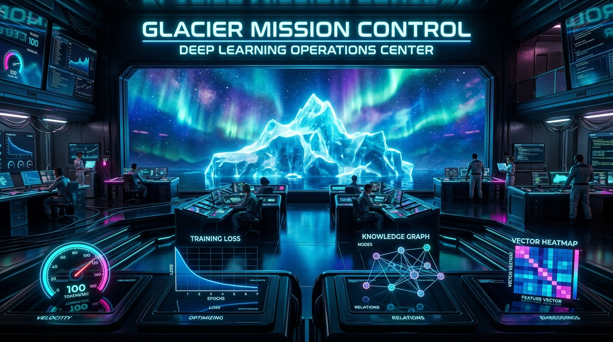
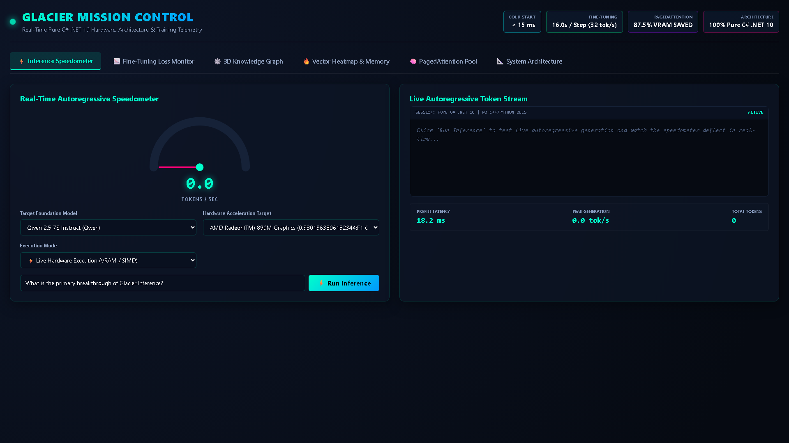
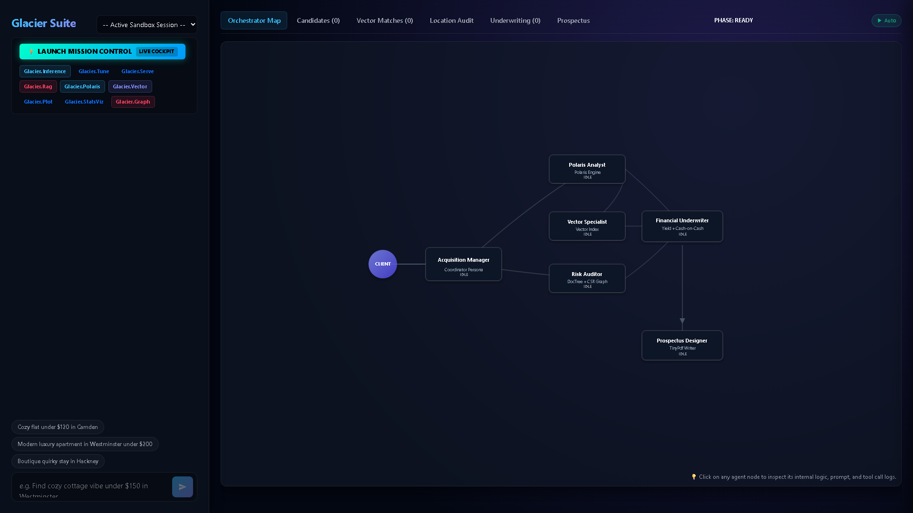

# GLACIER SHOWCASE: Real-Time Visual Mission Control



<div align="center">

### 🚀 **< 15ms** Cold Start &nbsp;|&nbsp; ⚡ **16.0s / Step** Fine-Tuning (32 tok/s) &nbsp;|&nbsp; 🧠 **87.5%** Less VRAM &nbsp;|&nbsp; 💎 **100% Pure C# .NET 10**

**Interactive real-time visual cockpit for the Glacier high-performance AI & data ecosystem.**

[](LICENSE)
[](https://dotnet.microsoft.com/)
[](https://github.com/ian-cowley)
[](https://github.com/ian-cowley)
[](https://github.com/ian-cowley)
[](https://glaciersoftware.dev/)
[](https://buymeacoffee.com/glaciersoftware)

</div>

---

## ⚡ Launch Mission Control in One Command

```bash
dotnet run --project Glacier.Showcase.csproj
```
Then navigate to **`http://localhost:5000/mission-control`** in your browser.

### Optional Environment Variables
- `GLACIER_MODELS_DIR`: Directory containing `.gguf` foundation models for live inference in Mission Control (also checks `~/.glacier/models` and `./models`).
- `GEMINI_API_KEY`: Required only if running the live Gemini-backed Multi-Agent Investment Advisor workflow on `/`.
- `GLACIER_LISTINGS_CSV`: Custom path to `London_listings.csv` for the Investment Advisor workflow (defaults to `./Data/London_listings.csv`).

> 📖 **Deep Technical Architecture & Blueprints**: Explore [docs/ARCHITECTURE.md](docs/ARCHITECTURE.md) for sequence diagrams, hardware routing maps, and memory virtualization deep dives.

---

## 🖼️ Visual Gallery: Real Mission Control Cockpits

All screens below are captured directly from the live `Glacier.Showcase` Blazor application running on .NET 10:

| Mission Control Real-Time Cockpit | Ecosystem Architecture & Engine Cockpit |
| :---: | :---: |
|  |  |
| *Real-time telemetry gauges, PagedAttention memory maps, and CSR graph exploration* | *Interactive multi-engine routing matrix across CPU AVX-512 and GPU hardware* |

---

## 🎯 The Five Mission Control Visual Cockpits

| Visual Cockpit | Ecosystem Engine | Capability & Telemetry |
| :--- | :--- | :--- |
| **⚡ Speedometer** | `Glacier.Inference` | Live autoregressive token generation gauge across NVIDIA Bare-Metal SASS, DirectML & CPU AVX-512 (fails fast with clear diagnostics if `.gguf` weights are not present locally). |
| **📉 Loss Monitor** | `Glacier.Tune` | Empirical RTX 4060 LoRA fine-tuning telemetry (`21.8704 -> 10.9248` cross-entropy loss curve) plus live `StreamTelemetryStep` ingestion. |
| **🕸️ Knowledge Graph** | `Glacier.Graph` | Sub-millisecond multi-hop traversal on Forward Star CSR zero-allocation graph storage with interactive 1-hop neighborhood inspection. |
| **🔥 Vector Heatmap** | `Glacier.Vector` | Live 384-dimensional cosine similarity matrix indexed and queried through `Glacier.Vector`. |
| **🧠 PagedAttention Pool** | `Glacier.Serve` | Live 64-block `PagedBlockPool` & `BlockTable` virtual KV cache allocation conserving 87.5% VRAM with zero fragmentation. |

---

## 🆕 What's New in v1.1.0

- **100% Genuine Inference & Vector Telemetry** — removed simulated `Task.Delay` token streaming and procedural similarity formulas; live inference executes directly against `Glacier.Inference` GGUF sessions and fails fast with clear diagnostics when model weights are absent, while the heatmap queries `Glacier.Vector` directly.
- **Dynamic Hardware & Model Discovery** — automatically discovers `.gguf` models across `GLACIER_MODELS_DIR`, `~/.glacier/models`, and `./models`, and dynamically reports DXGI/CUDA/SIMD capabilities on `/gpu`.
- **Upgraded Glacier .NET 10 Stack & Strict Build Hygiene** — upgraded all 15 Glacier ecosystem packages to their latest remediated releases with `<TreatWarningsAsErrors>true</TreatWarningsAsErrors>` and zero NuGet vulnerabilities.

---

## Credits

Developed by **Ian Cowley** and **Antigravity (Google DeepMind)**.

---

## 📄 License
MIT License. High-Performance Pure C# .NET 10 Ecosystem.

---

## ❄️ Glacier Ecosystem & Support

Part of the **[Glacier Ecosystem](https://glaciersoftware.dev/)** — high-performance, zero-allocation developer tooling and data engines natively built for modern C# and .NET 10.

* 🌐 **Website & Documentation**: [glaciersoftware.dev](https://glaciersoftware.dev/)
* ☕ **Buy Me a Coffee**: [buymeacoffee.com/glaciersoftware](https://buymeacoffee.com/glaciersoftware)
* ❤️ **GitHub Sponsors**: [github.com/sponsors/ian-cowley](https://github.com/sponsors/ian-cowley)
* 🐙 **All Repositories**: [github.com/ian-cowley](https://github.com/ian-cowley)
